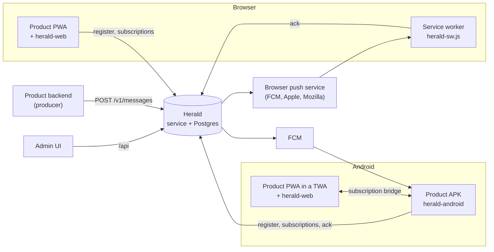
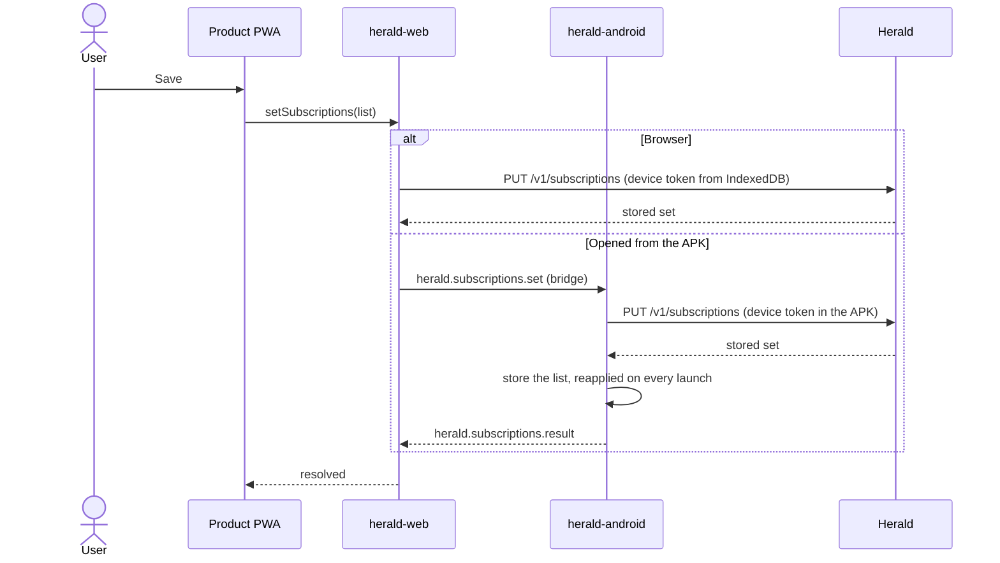
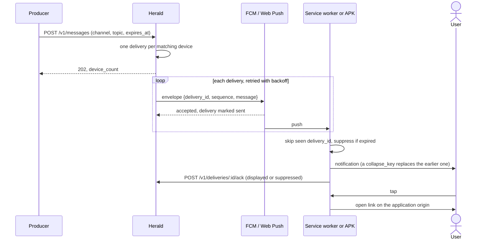
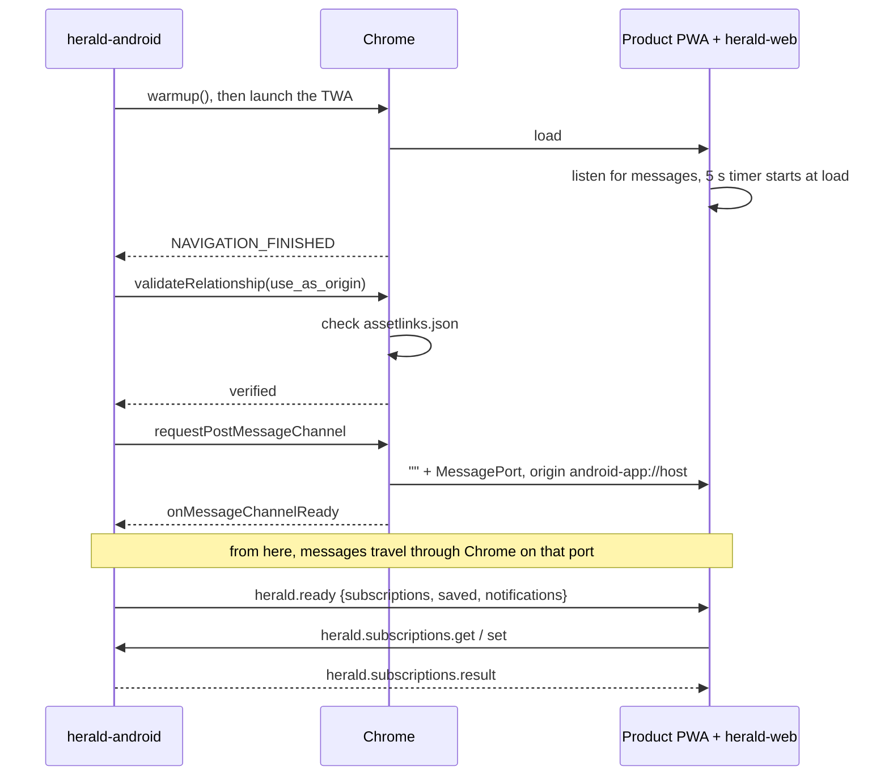

# Architecture

Herald delivers notifications for several products from one service. It has
five parts, and each owns one concern:

| Part | Repository | Owns |
|---|---|---|
| Herald service | `herald` | Applications, the routing catalog, devices, subscriptions, fan-out, retries, delivery records |
| Admin UI | `herald/admin` | Operator view: applications, catalog, producers, history, test sends |
| Producer | the product's backend | Deciding what to send: channel, topic, priority, text, expiry |
| herald-web | `herald-web` | Browser transport: Web Push registration, the service worker, the page side of the Android bridge |
| herald-android | `herald-android` | Android transport: FCM registration, native notifications, the Trusted Web Activity, the APK side of the bridge |

The product's PWA owns **what a user wants**: its settings UI and the mapping
from each option to channels and topics. herald-web and herald-android carry a
full subscription list to Herald and know nothing about what the topics mean.
Herald stores the list and matches every publish against it. The producer
never sees devices or preferences; it publishes to a topic and Herald finds
the recipients.

The wire contract is [protocol-v1.md](protocol-v1.md). This document explains
how the parts fit together.

## Model

- An **application** is one product: a slug, an origin, and its own VAPID
  keypair ([ADR 0002](adr/0002-vapid-keys-per-application.md)).
- A **channel** is a notification category shipped in the product APK
  (`alerts`, `system`). On Android it is also the notification channel, the
  unit users can silence in system settings.
- A **topic** is a finer route within a channel, managed in the application's
  routing catalog ([ADR 0009](adr/0009-routing-catalog.md)).
- A **device** is one browser profile or one APK install. It holds a device
  token that only the client knows.
- A **subscription** is `(channel, topic)`. An empty topic matches the whole
  channel. A device's subscription set is always replaced whole, never patched.
- A **delivery** is one message to one device. It moves from `pending` to
  `sent`, then to the client's ack status (`displayed`, `delivered` or
  `suppressed`), or ends `failed`, `expired` or `superseded`.

## Flows

### Turning notifications on

In a browser, the page calls herald-web's `enable()`:

1. It asks for notification permission (this needs a user gesture) and
   subscribes the browser's push manager with the application's VAPID public
   key (`GET /v1/applications/:slug/vapid-public-key`).
2. `POST /v1/devices/register` with the push subscription returns the device ID
   and token, which herald-web stores in IndexedDB for the page and the service
   worker.
3. `PUT /v1/subscriptions` stores the chosen set.

In the Android APK, herald-android registers on first launch with its Firebase
Installation ID. Until the PWA chooses, it subscribes to every channel in its
`herald.json`, each with an empty topic.

### Changing preferences

The product's Save button calls the same herald-web function on either
platform: `setSubscriptions(list)`, or `disable()` for an empty list.

- **Browser.** herald-web calls `PUT /v1/subscriptions` from the page with the
  device token. The service worker is not involved.
- **Android app.** The device token stays in the APK, so the page asks the APK
  over the subscription bridge. The APK calls `PUT /v1/subscriptions`, stores
  the list, and reapplies it on every later launch. On first open, herald-web
  reports `saved: false`, and the product applies its default set.

herald-web decides which path to take: a page opened from the APK (an
`android-app://` referrer) uses the bridge, and it removes any web
registration left from when the same site was a plain browser tab.

### Publishing and delivery

1. The producer calls `POST /v1/messages` with its producer token
   ([publishing.md](publishing.md)).
2. Herald records the message and creates one delivery for every device with a
   matching subscription, in the same transaction. Deliveries are only created
   here: a device that subscribes later does not receive earlier messages.
3. A dispatcher sends each delivery through FCM (Android) or Web Push
   (browsers), retrying with backoff. Push-service acceptance marks it `sent`.
4. The client deduplicates on `delivery_id`, suppresses anything already
   expired, shows a notification, and acks: `displayed` or `suppressed`.
5. A tap opens the message's `link`, resolved against the application origin.
   Anything else falls back to the product's start URL.

The client side of steps 4 and 5 is herald-web's service worker in a browser,
and herald-android's messaging service in the APK. A collapse key replaces the
visible notification with the same key on both.

## The Android subscription bridge

The APK opens the product PWA as a Trusted Web Activity in Chrome. The page and
the APK talk over the Custom Tabs postMessage channel. The messages are listed
in herald-android's README.

How Chrome opens that channel is not obvious, and each detail below is
required:

1. **Asset links.** The site's `/.well-known/assetlinks.json` must grant the
   APK's signing certificate `delegate_permission/common.use_as_origin`, in
   addition to `handle_all_urls` for the TWA itself.
2. **Warmup.** Chrome refuses `validateRelationship`, `requestPostMessageChannel`
   and `postMessage` until some client has called `warmup()`. android-browser-helper
   skips warmup on current Chrome, so herald-android calls it alongside the
   launch.
3. **Order.** The APK validates `use_as_origin` and requests the channel on the
   first `NAVIGATION_FINISHED`, that is after the page's `load` event. Chrome
   reopens the channel after every full navigation.
4. **Opening message.** Chrome opens the channel by posting an empty string to
   the page with a `MessagePort` attached. Every APK message, `herald.ready`
   first, arrives on that port.
5. **Origin.** That opening message comes from `android-app://<verified
   host>`, not the page's `https://` origin. herald-web accepts only that
   origin, which Chrome uses only after verification and no web page can send
   from.
6. **Timeout.** herald-web waits 5 seconds after `load` for `herald.ready`. With
   no answer, it reports the environment as managed by the Android app.

If the APK process is killed while its TWA stays open, the page still has its
port, but nothing answers. A save then fails after 15 seconds until the app is
opened again from its icon.

## Debugging

- **What a device is subscribed to:** the `subscriptions` table for that
  device. The admin UI does not show per-device subscriptions.
- **Whether a message reached a device:** notification history in the admin
  UI: per-state delivery counts and error reasons.
- **Android bridge:** remote-debug the TWA with adb:
  `adb forward tcp:9229 localabstract:chrome_devtools_remote`, then attach to
  the page and log `message` events. `adb logcat` shows herald-android's
  warnings under the `Herald` tag; Chrome's release builds strip its own
  Custom Tabs debug logging.
- **Browser push not arriving:** some browsers route push through a vendor
  service the user can turn off. Brave needs "Use Google services for push
  messaging" enabled.

Operating the service itself is covered in [operations.md](operations.md).
